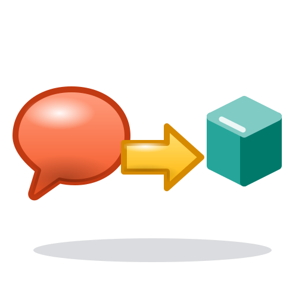

# CustomGPT-to-Skill

<p align="center">
  
</p>

<p align="center">
  <a href="#installazione"></a>
  
  <a href="README.md"></a>
</p>

Converte un **Custom GPT** (istruzioni + file Knowledge + icona + metadati) in un pacchetto **Universal Skill** (formato aperto `SKILL.md`) — senza perdere in silenzio comportamento, file o controllo.

Si basa su un unico principio:

> **Preservare il comportamento prima delle parole. Non perdere mai un asset in silenzio. Ogni scelta rilevante spetta all'essere umano.**

🇬🇧 [Read in English](README.md)

---

## Perché esiste

Un Custom GPT è facile da costruire e difficile da *possedere*. Nel tempo accumula vera ingegneria: confini di rifiuto, contratti di output, regole di fallback, una Knowledge base curata e, a volte, un "control plane" a più livelli: file che dicono al modello cosa caricare, in quale ordine e chi prevale in caso di conflitto. Tutto questo vive dentro l'interfaccia di un solo vendor, non si può confrontare (diff), revisionare, calcolare in hash, versionare o testare in CI, ed è limitato dalla piattaforma (un numero ridotto di file Knowledge per GPT, recuperati da una pipeline non ispezionabile — per le cifre esatte consulta l'Help Center OpenAI aggiornato).

Le Skill risolvono il problema della proprietà: una cartella di file di testo (`SKILL.md`, `references/`, `scripts/`, `assets/`) che vive in Git e viene caricata on demand dai runtime agentici che supportano il formato aperto.

Ma **copiare il system prompt di un GPT dentro un `SKILL.md` non è una migrazione**. I porting ingenui tipicamente:

- perdono file Knowledge, oppure li appiattiscono (DOCX → Markdown perde commenti, revisioni, campi, tabelle, ordine di lettura);
- conservano i file ma perdono *quando* vanno letti (ordine di bootstrap, precedenze, routing, macchine a stati);
- trasformano una persona persistente in un prompt one-shot;
- referenziano icone o tool mai impacchettati o inesistenti nel runtime di destinazione;
- dichiarano "funziona" senza nulla con cui verificarlo.

CustomGPT-to-Skill trasforma la migrazione in un processo **verificabile, con approvazioni umane e test di regressione**:

| Aspetto | Cosa fa la skill |
|---|---|
| Nulla va perso | Inventario con hash (percorso, media type, dimensione, SHA-256) e confronto dei manifest sorgente→target che fallisce sulle omissioni non spiegate |
| Fedeltà della Knowledge | Preservazione byte per byte in `references/kb/original/` + `kb-manifest.json`; i mirror derivati non sono autorevoli |
| GPT a strati | Rileva artefatti `PASSIVE_KB` / `OPERATIONAL_CONTROL` / `MIXED`; conserva gli originali canonici *e* una rappresentazione eseguibile a runtime, con ordine di bootstrap e verifica di parità |
| Persone persistenti | Rilevamento consultivo + conferma umana + eventuale Conversation Session Lock consapevole dell'host (non dichiara mai di poter forzare la re-invocazione da parte dell'host) |
| Validation harness | Conserva l'harness già presente nella sorgente; propone un harness per famiglia di task solo con approvazione esplicita |
| Controllo umano | Ogni scelta rilevante viene spiegata (motivazione + conseguenza pratica) *prima* di chiederti conferma; un **Conversion Parameter Report** deterministico mostra cosa è stato scelto e perché |
| Reporting onesto | Il dashboard finale separa le validazioni *eseguite* da quelle *non eseguite* ed elenca i gap di capacità non supportati |
| Sicurezza da regressioni | 31 invarianti di feature (F001–F031) e una suite di self-test proteggono il convertitore stesso |

## Plugin vs. una skill nata dal tuo GPT

"Usa un plugin" è la risposta tipica a "come riuso questo GPT altrove?". I plugin sono lo strumento giusto per certi compiti — e quello sbagliato per questo.

**Dove i plugin sono forti:** dare a un agente *accesso* — dati live, API SaaS, azioni di scrittura con effetti collaterali. Una skill può *chiamarli*: i due approcci sono complementari, non concorrenti.

**Dove le integrazioni in stile plugin non bastano per migrare un GPT:**

1. **Portano accesso, non metodo.** Ciò che rende prezioso un GPT è il suo *comportamento*: perimetro, gate, regole di rifiuto, contratti di output, semantica dei fallimenti. Un plugin espone tool; non ha un posto naturale per "esegui questi passi in questo ordine e fermati se questo controllo fallisce".
2. **Accoppiamento a runtime e vendor.** I plugin si agganciano a un harness o marketplace specifico. Il rischio di ciclo di vita è concreto — il sistema originale di plugin di ChatGPT è stato dismesso a favore di GPT e Actions, e le integrazioni legate a un solo runtime ereditano la stessa fragilità.
3. **Opacità.** Endpoint remoti, aggiornamenti di marketplace e descrizioni dei tool possono cambiare sotto i piedi. Una skill è testo e script locali: confrontabili, revisionabili, con hash, fissati a un commit.
4. **Uscita dei dati e attriti di approvazione.** Plugin e connettori in genere inviano dati a terzi e richiedono approvazioni a livello di organizzazione. Per materiale sensibile o regolamentato, "file locali e script deterministici" è spesso l'unica forma accettabile.
5. **Granularità grossolana.** Un plugin si installa come unità e viene selezionato dalle descrizioni dei tool. Non può esprimere control plane a strati, policy di persistenza della persona o conferma umana per singolo gate.
6. **Nessun posto per un corpus preservato.** Knowledge byte-exact con manifest di hash, caricata in modo selettivo, è una questione di struttura dei file — non qualcosa che un connettore fornisce.
7. **Non testabili offline.** Un repo di skill esegue controlli di regressione in CI a ogni commit. Un'integrazione ospitata è difficile da fissare e da riprodurre.

**Perché una skill derivata dal vecchio GPT è spesso il punto di partenza migliore:**

- **Le iterazioni le hai già pagate.** Le istruzioni del GPT codificano comportamenti testati sull'uso reale. Preservare quel contratto costa meno ed è più sicuro che rideriverlo da zero.
- **La Knowledge esce dalla gabbia.** I file vivono nel repo con provenienza, invece che dietro uno slot di upload limitato e un retriever opaco.
- **Portabilità.** `SKILL.md` è un formato aperto, basato su cartelle, supportato da un numero crescente di runtime agentici: il pacchetto non resta legato al prodotto in cui è nato.
- **Progressive disclosure.** La description della skill è l'unico costo di contesto permanente; il dettaglio in `references/` si carica solo quando serve.
- **Determinismo dove conta.** Hashing, validazione, size gate e normalizzazione delle icone sono script, non improvvisazione del modello.
- **Proprietà.** Storia Git, code review, CI e changelog.

**Quando *non* migrare un GPT con questo strumento:** il valore del GPT sta soprattutto nelle sue **Actions** live con OAuth ed effetti collaterali (ricreale come connettori/MCP e tieni la skill per il metodo); dipendi dalla distribuzione o monetizzazione dello GPT Store; ti serve l'UX vocale/mobile o la memoria di piattaforma; oppure il runtime di destinazione non può eseguire script inclusi. La skill segnala questi casi come **conversion gap** espliciti invece di inventare sostituti.

> Le skill non sono prive di rischi: girano con i permessi dell'agente che le carica (spesso una shell). Leggi qualsiasi skill — comprese le conversioni prodotte da questa — prima di installarla. Vedi [SECURITY.md](SECURITY.md).

## Cosa fa

Dato un export di Custom GPT (ZIP, oppure documento di istruzioni + file Knowledge), la skill:

1. inventaria ogni asset sorgente con SHA-256;
2. individua la fonte canonica delle istruzioni dal *contenuto*, non dal nome del file;
3. estrae gli invarianti comportamentali (trigger · comportamento richiesto · scorciatoia vietata · obbligo di output · evidenza di preservazione);
4. classifica gli artefatti di control plane e, se serve, si ferma per una scelta di strategia umana;
5. rileva/preserva i controlli di harness; ne propone di nuovi solo con approvazione;
6. classifica i GPT conversazionali e subordina la gestione del persona-drift a un gate;
7. preserva la Knowledge byte per byte; subordina a gate la gestione dei DOCX e ogni riduzione di dimensione;
8. costruisce `SKILL.md`, `agents/openai.yaml`, icone (`icon.png` 64×64 + `icon.svg` autocontenuta) e solo i file di supporto che aiutano davvero;
9. esegue regressione e validazione strutturale e confronta i manifest sorgente/target;
10. consegna `skill.zip` più un dashboard di conversione.

## Flusso principale

```text
Export del Custom GPT
  ↓
Inventario sorgente (SHA-256)
  ↓
Human-in-Control: Decision Awareness Guide → conferma esplicita
  ↓
Gate: control plane · harness · conversazionale · DOCX
  ↓
Conversion Parameter Report (deterministico, mostrato all'utente)
  ↓
Generazione del target (Skill + originali KB + icone)
  ↓
Regressione · validazione strutturale · confronto manifest · size gate
  ↓
skill.zip + dashboard di conversione
```

## Installazione

Installa direttamente da GitHub con la CLI aperta `skills`:

```bash
npx skills add jumpifequal/customgpt-to-skill
```

Controlla cosa rileva la CLI prima di installare:

```bash
npx skills add jumpifequal/customgpt-to-skill --list
```

Installazione globale per un agente specifico:

```bash
npx skills add jumpifequal/customgpt-to-skill -g -a codex -y
npx skills add jumpifequal/customgpt-to-skill -g -a claude-code -y
```

Installazione da clone locale:

```bash
git clone https://github.com/jumpifequal/customgpt-to-skill.git
cd customgpt-to-skill
npx skills add .
```

Verifica il repository prima dell'installazione o di un contributo:

```bash
python -m pip install -r requirements-dev.txt
python tools/validate_repo.py
```

> `npx skills add` installa la skill. Il repository non richiede `npm install`; Node.js/npm servono solo per eseguire la CLI `skills`. Le icone sorgente SVG richiedono inoltre `cairosvg` (non necessario per la suite di test).

## Avvio rapido

Allega l'export del tuo Custom GPT (oppure istruzioni + file Knowledge + icona opzionale) e scrivi:

```text
Use $customgpt-to-skill to convert my attached Custom GPT export into a validated Universal Skill package.
```

Trigger naturali tipici: *converti / porta / migra / ricostruisci questo Custom GPT come Skill*; *trasforma questo export GPT in una skill*; *rilancia la conversione GPT→skill con i nuovi file Knowledge*.

Verrai guidato attraverso una **Decision Awareness Guide**; nulla viene generato finché non confermi.

## Moduli di supporto

| Script | Scopo |
|---|---|
| `build_inventory.py` | Inventario deterministico sorgente/target con hash |
| `kb_preserve.py` | Migrazione Knowledge byte per byte + manifest |
| `icon_convert.py` | Normalizzazione sicura delle icone PNG/SVG |
| `detect_conversational_gpt.py` | Classificazione conversazionale consultiva |
| `harness_profile_selector.py` | Raccomandazione consultiva della famiglia di harness |
| `decision_gate_guard.py` | Valida tutti i gate umani |
| `render_parameter_report.py` | Genera/valida il Conversion Parameter Report |
| `control_plane_guard.py` | Valida mappa di control plane e parità |
| `conversation_lock_guard.py` | Valida le integrazioni di conversation lock |
| `package_size_guard.py` | Dimensione compressa stimata vs. 25 MiB |
| `validate_converted_skill.py` | Validazione strutturale/semantica della skill generata |
| `regression_self_test.py` | Self-regressione del convertitore (F001–F031) |

## Struttura del repository

```text
customgpt-to-skill/
├── .github/
│   └── workflows/
│       └── validate.yml
├── agents/
│   └── openai.yaml
├── assets/
│   ├── icon.png          # icona UI della skill (64×64)
│   └── icon.svg
├── docs/
│   ├── assets/
│   │   ├── logo.png      # logo del repository
│   │   └── logo.svg
│   ├── architecture.md
│   ├── decision-gates.md
│   ├── examples.md
│   └── runtime-tools.md
├── references/           # policy normative di conversione
├── scripts/              # helper deterministici + suite di regressione
├── tools/
│   └── validate_repo.py
├── CHANGELOG.md
├── CONTRIBUTING.md
├── README.md
├── README.it.md
├── SECURITY.md
├── SKILL.md              # punto di ingresso
└── requirements-dev.txt
```

## Documentazione

- [Architettura](docs/architecture.md)
- [Decision gates](docs/decision-gates.md)
- [Runtime tools](docs/runtime-tools.md)
- [Esempi d'uso](docs/examples.md)
- [Changelog](CHANGELOG.md)

La documentazione tecnica in `docs/` è in inglese; `SKILL.md` e `references/` restano la fonte canonica.

## Vincoli di progetto

La skill preferisce deliberatamente:

- una decisione umana a un default silenzioso;
- originali preservati a conversioni comode;
- conversion gap espliciti a capacità inventate;
- regressione guidata dagli invarianti a una validità solo di schema;
- "validazione non eseguita" a un "validato" non verificabile.

## Versione

Skill `10.7.0` — vedi [CHANGELOG.md](CHANGELOG.md).

Autore: **Enrico Frumento**

## Licenza

Nella skill sorgente non è dichiarata alcuna licenza. Aggiungi la licenza adatta alla tua politica di pubblicazione e redistribuzione prima del rilascio pubblico, se necessario.
